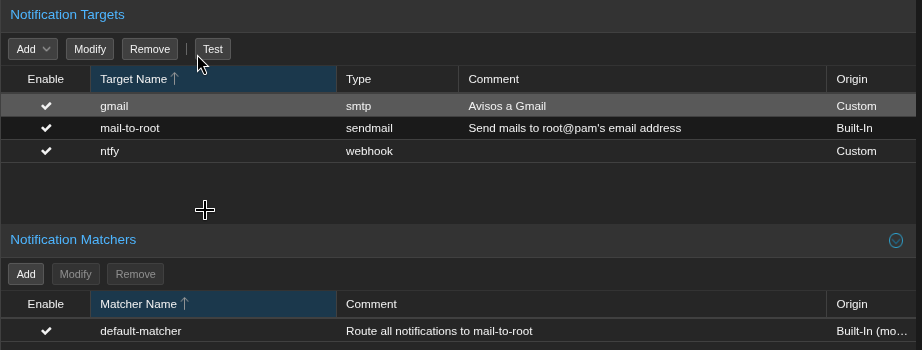

# Fase 8: Endurecimiento del host Proxmox

Se hace por partes, de la más simple a la que más riesgo tiene de dejarte sin acceso: SSH con llave → 2FA → fail2ban → firewall. El firewall va al final porque una regla mal puesta corta el acceso remoto, así que se hace con teclado y pantalla conectados al servidor.

## 1. SSH solo con llave

La llave `ed25519` de la PC ya estaba instalada en el host desde la fase 7. Quedaba desactivar el login por contraseña.

En vez de editar `/etc/ssh/sshd_config`, se añadió un archivo en `sshd_config.d/`. La línea `Include` está al principio del archivo principal y en sshd **gana el primer valor que aparece**, así que este archivo tiene prioridad sobre `PermitRootLogin yes`:

```sh
cat > /etc/ssh/sshd_config.d/00-solo-llave.conf <<'EOF'
PermitRootLogin prohibit-password
PasswordAuthentication no
KbdInteractiveAuthentication no
EOF
sshd -t && systemctl reload ssh
```

`sshd -t` valida la sintaxis antes de recargar. Si hay un error, el servicio no se toca. `reload` no corta las sesiones que ya están abiertas.

### Qué no cambia

- La **web de Proxmox (8006)** usa su propio login, no SSH. Se entra con usuario y contraseña igual que antes.
- La **Shell del nodo** en la web tampoco pasa por SSH. Si se pierde la llave, se puede revertir desde ahí borrando el archivo.

### Prueba

- `sshd -T` → `permitrootlogin without-password`, `passwordauthentication no` ✅
- Conexión nueva con llave → entra ✅
- Conexión forzando contraseña → `Permission denied (publickey)` ✅
- Web 8006 → HTTP 200 ✅

## 2. Usuario administrador propio y 2FA

Para el uso diario se creó un usuario en el realm **`pve`** (Proxmox VE authentication server), no en PAM:

- Con `pve`, la contraseña la guarda Proxmox y el usuario **no existe en Linux**, así que no puede entrar al host por SSH.
- Con PAM habría que crear antes el usuario con `adduser` y además podría entrar por SSH.

Pasos:

1. *Datacenter → Permissions → Users → Add*, realm *Proxmox VE authentication server*, con contraseña.
2. *Datacenter → Permissions → Add → User Permission*: path `/`, rol `Administrator`, *Propagate* marcado. El botón *Permissions* de la lista de usuarios solo **muestra** permisos, no los asigna.
3. 2FA **TOTP** (app de autenticación) para el usuario nuevo **y** para `root@pam`. `root@pam` se conserva como acceso de emergencia, no se borra.

### Prueba

- `pveum acl list` → `/`, `Administrator`, propagate 1 ✅
- `pveum user tfa list` → TOTP en los dos usuarios ✅
- Login del usuario nuevo con código TOTP → OK ✅

### Si se pierde el celular

Desde SSH con la llave (paso 1): `pveum user tfa delete <usuario>@<realm>` y se vuelve a configurar.

## 3. fail2ban (web de Proxmox y login de Nextcloud)

fail2ban lee los logs y, cuando una IP falla demasiadas veces la contraseña, la bloquea en el firewall durante un tiempo.

### En el host: web de Proxmox (8006)

```sh
apt install fail2ban
```

Los fallos de login de la web los anota `pvedaemon` en el journal:

```
pvedaemon[…]: authentication failure; rhost=::ffff:192.168.1.x user=… msg=Authentication failure
```

Filtro `/etc/fail2ban/filter.d/proxmox.conf`:

```ini
[Definition]
failregex = pvedaemon\[.*authentication failure; rhost=(::ffff:)?<HOST> user=.* msg=.*
ignoreregex =
journalmatch = _SYSTEMD_UNIT=pvedaemon.service
```

Jail `/etc/fail2ban/jail.d/proxmox.local` (3 fallos en 2 días → 1 hora bloqueado):

```ini
[proxmox]
enabled   = true
port      = https,http,8006
filter    = proxmox
backend   = systemd
banaction = nftables-multiport
maxretry  = 3
findtime  = 2d
bantime   = 1h
```

En Debian 13 el jail `sshd` ya viene activado (`defaults-debian.conf`). Con SSH solo por llave casi no tiene trabajo, pero no estorba.

### En el CT 100: login de Nextcloud

La plantilla TurnKey ya trae fail2ban con un jail `nextcloud` (3 fallos en 12 h → 24 h bloqueado), pero **el servicio no arrancaba**: `Have not found any log file for nextcloud jail`. El jail seguía apuntando al log en la carpeta de datos antigua, que se movió a `/var/log/nextcloud` en la [fase 5](05-endurecimiento-nextcloud.md). Se arregló en tres pasos:

```sh
# 1. Ruta nueva del log
sed -i 's#/var/www/nextcloud-data/nextcloud.log#/var/log/nextcloud/nextcloud.log#' /etc/fail2ban/jail.d/nextcloud.local

# 2. Nivel de log 2 (warning): con 3 (error) los "Login failed" no se anotan
runuser -u www-data -- php /var/www/nextcloud/occ config:system:set loglevel --value=2 --type=integer

# 3. No bloquear nunca al host (ver abajo)
#    /etc/fail2ban/jail.local → ignoreip = 127.0.0.1/8 ::1 192.168.1.44
```

**Por qué se ignora `192.168.1.44`:** el host es el subnet router de Tailscale ([fase 6](06-tailscale.md)), así que Nextcloud ve **todas** las conexiones remotas como si vinieran de la IP del host. Si fail2ban la bloqueara, se cortaría el acceso remoto de todos los dispositivos durante 24 h. Lo que entra por Tailscale sigue protegido por la protección contra fuerza bruta propia de Nextcloud y por el 2FA.

### Prueba

- `fail2ban-regex systemd-journal /etc/fail2ban/filter.d/proxmox.conf` → el filtro reconoce los fallos de login reales del journal (11 coincidencias) ✅
- `fail2ban-client status` en el host → jails `proxmox` y `sshd` activos ✅
- `fail2ban-client status nextcloud` en el CT 100 → servicio activo, vigilando `/var/log/nextcloud/nextcloud.log` ✅

### Uso

```sh
fail2ban-client status proxmox                 # en el CT 100: nextcloud
fail2ban-client set proxmox unbanip <IP>       # desbloquear
grep -E "Ban|Unban" /var/log/fail2ban.log      # historial de bloqueos
```

Si el bloqueado es uno mismo y no se puede entrar por SSH, el `unbanip` se ejecuta con teclado y pantalla en el servidor.

## 4. Monitoreo SMART y avisos (ntfy + correo)

El HDD de 1 TB guarda los archivos de Nextcloud **y** sus backups, y ya trae ~18 000 h de uso. Si muere, se pierde todo a la vez. SMART suele avisar semanas antes (sectores reasignados o pendientes que empiezan a subir), pero solo sirve si el aviso llega a alguien.

Estado de partida: los dos discos en `PASSED`, 0 sectores reasignados o pendientes en el HDD, 16 % de vida usada en el NVMe. `smartd` ya viene activo en Proxmox, pero con la configuración por defecto **no programa autotests** y los avisos se quedaban en el buzón local de `root`.

### Avisos: notificaciones de Proxmox

Proxmox redirige el correo de `root` (`/root/.forward` → `proxmox-mail-forward`) a su sistema de notificaciones (Datacenter → Notifications). Así, los avisos de smartd, de los backups y de las actualizaciones pasan todos por el mismo sitio.

| Destino | Tipo | Configuración |
|---|---|---|
| `ntfy` | Webhook | `POST https://ntfy.sh/{{ secrets.topic }}`, header `Title: {{ title }}`, cuerpo `{{ message }}` |
| `gmail` | SMTP | `smtp.gmail.com`, TLS (465), con contraseña de aplicación de Google |

El matcher `default-matcher` (atrapa todas las notificaciones) envía a los dos destinos.



**Por qué el tema de ntfy va en *Secrets*:** en ntfy.sh cualquiera que sepa el nombre de un tema puede leerlo, así que el nombre funciona como una contraseña. Se generó al azar (`openssl rand -hex 12`) y como *secret* no se muestra en la interfaz ni en `notifications.cfg`.

**Por qué una contraseña de aplicación:** Gmail no acepta la contraseña normal por SMTP. La de aplicación solo sirve para enviar correo y se puede revocar sin tocar la cuenta. Lo ideal es que envíe una cuenta dedicada al servidor, no la personal: si alguien compromete el servidor, solo podría usar esa cuenta.

### Autotests: `/etc/smartd.conf`

Se comentó la línea `DEVICESCAN` original y se puso esta:

```
DEVICESCAN -a -o on -S on -n standby,q -s (S/../.././02|L/../../6/03) -W 4,45,55 -m root -M exec /usr/share/smartmontools/smartd-runner
```

| Opción | Qué hace |
|---|---|
| `-a` | Vigila todos los atributos y la salud general |
| `-s (S/../.././02\|L/../../6/03)` | Test corto todos los días a las 02:00; largo (lee el disco entero, ~3 h) los sábados a las 03:00, para no chocar con el backup del domingo a las 03:00 |
| `-W 4,45,55` | Avisa si la temperatura sube 4 °C de golpe, la anota pasando de 45 °C y da alerta crítica a partir de 55 °C |
| `-n standby,q` | No despierta el disco si está dormido |
| `-m root -M exec …` | Envía el aviso a `root`, que llega a las notificaciones de Proxmox |

Para probar los avisos se añadió `-M test` temporalmente: al reiniciar `smartd` envía un aviso de prueba por cada disco. Después se quitó, porque si no llega uno en cada arranque.

### Prueba

- Botón **Test** de cada destino → llega el aviso al celular (ntfy) y el correo a Gmail ✅
- `-M test` → el journal muestra la cadena completa: `smartd-runner` → `proxmox-mail-forward` → `notified via target ntfy` ✅
- `smartctl -t short /dev/sda` → `Completed without error` ✅
- `smartd -q showtests` → próximos tests cortos diarios y largos los sábados ✅

### Uso

```sh
smartctl -H -A /dev/sda       # salud y atributos (fijarse en 5, 197 y 198: deben seguir en 0)
smartctl -l selftest /dev/sda # historial de autotests
smartd -q showtests           # próximos tests programados
```

Los "Aborted by host" antiguos del historial del HDD son de su uso anterior, cuando el equipo se apagaba en medio del test. No indican un fallo.
